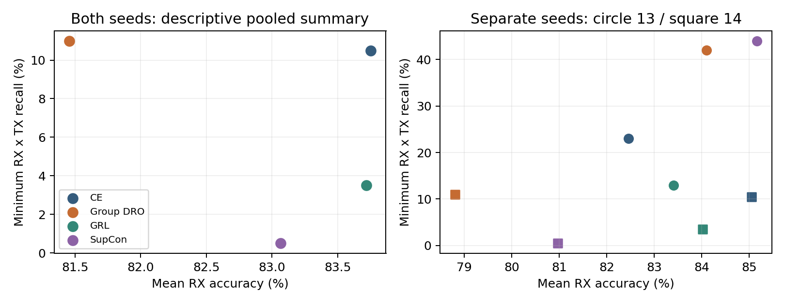
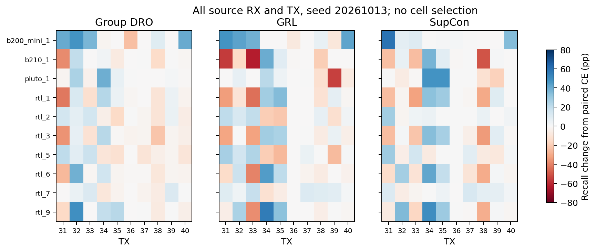
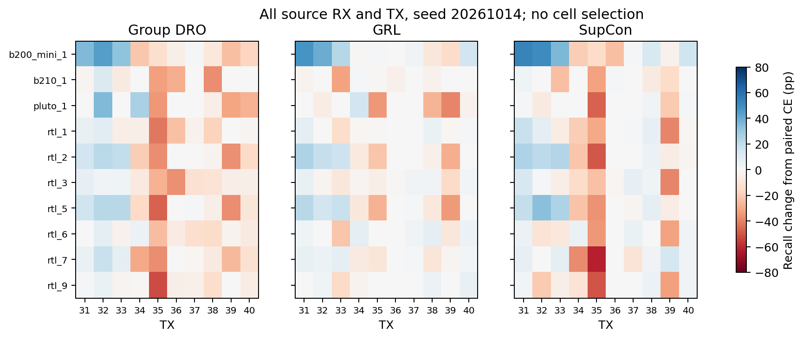

# B1：标准机制基线已完成，仍有平均与尾部权衡

2026-10-13 UTC。独立分支 `experiment/b1-standard-baselines`，来源为已发布的 `2b89877ae4ec7f95b733faa30381f6e3c6f50518`。用户批准32次作业、2 reserved V100 GPU小时；32/32完成、0失败、0重试、0替换seed，总占用 **0.470496 GPUh**。全部预登记配方和训练代码seal通过，完成后停止。

本轮固定有限配方下，Group DRO、GRL、SupCon没有同时达到“平均Accuracy不降、全局最低RX×TX Recall提高”的描述性共同改善。种子差异明显：三种方法在seed13都提高平均Accuracy，在seed14都下降。结果支持继续审核剩余风险，**不足证明普通方法普遍失败、作者级强方法失效或新算法必要**。不启动ArcFace、B2或新Loss。

## 公平配方、数据边界和选择

十历史源RX、TX31–40、每RX×TX200包，同一Strict CIS和rank16 CNN，658314推理参数。两折的五源RX拟合、另五源RX评价；RX清单见[注册](../../../configs/b1_baselines/registration.json)。源码与输入在first优化前封存，[预执行seal](../../../configs/b1_baselines/pre_execution_seal.json)逐文件记录SHA；历史审核矩阵原字节保留，其旧“未批准”字段是历史状态，最新许可在新registration和AGENTS.md中记录。

16内部搜索：每外层五训练RX中固定一RX内部验证、其余四RX训练；seed20261015、10轮、lr∈{1e-4,3e-4}、固定末轮macro-F1，精确分数完全平手取较小lr。搜索不打开外层评价RX，不选择epoch。16搜索全部完成后在2026-10-13T05:49:26.730846+00:00一次冻结LR，再运行16正式模型（两折×两seed×四方法），固定20轮后一次评价外层。

所有方法同训练包、逐seed相同base初始化、同stage/fold/seed保存的batch schedule。每RX×TX每batch两包；内部batch80、正式100，每轮100步且每包恰好一次。共480 model-epochs/48000 optimizer steps。scaler只在当前四/五拟合RX估计；Adam、WD0、clip5，无新增增强。有限源内选择允许不同方法获得不同LR，因此这里比较的是各自选定配方，不能把全部差异因果归结为损失项。

|折|方法|内部验证RX|选定LR|固定10轮内部macro-F1 (%)|
|---|---|---|---|---|
|0|CE|shen_rtl_6_train|0.0001|81.0611|
|0|Group DRO|shen_rtl_6_train|0.0003|83.5241|
|0|GRL|shen_rtl_6_train|0.0003|74.0099|
|0|SupCon|shen_rtl_6_train|0.0003|88.6797|
|1|CE|shen_pluto_1_train|0.0003|87.2082|
|1|Group DRO|shen_pluto_1_train|0.0003|83.8974|
|1|GRL|shen_pluto_1_train|0.0003|83.5840|
|1|SupCon|shen_pluto_1_train|0.0003|77.2024|

[冻结选择与所有候选](selection.frozen.json)、[16个内部结果](source_search_metrics.csv)公开。内部候选性能不能作为外层泛化结果。

- CE：普通分类CE，统一组均衡采样。
- Group DRO：RX×TX组均值CE；η=.01；q均匀初始化，每步q∝q·exp(η·group CE)，归一化、q脱离梯度；无额外正则/BTL/调整。
- GRL：原归一化512维feature加512→128→4/5 RX head，特征梯度反转系数.1，RX CE权重1。内部/正式额外66180/66309训练参数；head梯度正常，推理移除head。
- SupCon：CE+.1标准同TX正对SupCon，τ=baseτ=.1，排除self，一视图、无新投影网络。正式每anchor9个positive，其中8个跨RX；内部7个，其中6个跨RX。

这些是同架构机制对照；没有复现Shen完整GRL、Ma Siamese、IB-RFF FAN+IB。作者级输入适配限制保留于[前轮核查](../../../docs/d05_b0/AUTHOR_IMPLEMENTATION_AUDIT.md)。没有读取OSU、四开发/六锁定RX、Day3/4或原始IQ，也没有下载新大型数据。十源RX已被历史研究反复使用，当前结果是探索性源池评价。

## 全部正式结果

平均Accuracy与macro-F1按RX×seed等权（每方法20个RX×seed单元）；全局最低Recall取两seed×十RX×十TX的200格最小值。它不是平均最差类。另报每RX最差TX的平均Recall。≥10pp严重损害是对同fold/seed的本轮Strict CE计算，每方法200格，全部保留；B0 Full/Strict不混入loss归因。

|方法|平均Accuracy (%)|平均RX macro-F1 (%)|全局最低Recall (%)|平均RX最差TX Recall (%)|较CE下降≥10pp格数 /200|
|---|---|---|---|---|---|
|CE|83.7525|83.1899|10.5|53.575|—|
|Group DRO|81.4550|81.0196|11.0|52.550|49|
|GRL|83.7175|83.1299|3.5|56.425|36|
|SupCon|83.0650|82.3615|0.5|49.125|45|

相对CE，DRO平均Accuracy −2.2975pp、最低Recall +0.5pp；GRL平均Accuracy −0.035pp、最低Recall −7pp，但平均RX最差TX提高2.85pp；SupCon平均Accuracy −0.6875pp、最低Recall −10pp。最低值和平均尾部给出不同信息，不能只挑一个有利指标。详见[配对汇总](CE_comparison.csv)、[所有RX](per_RX.csv)、[800个Recall](per_RX_TX.csv)、[600个配对变化](paired_TX_changes.csv)。

|seed|方法|平均Accuracy (%)|全局最低Recall (%)|
|---|---|---|---|
|20261013|CE|82.455|23.0|
|20261013|Group DRO|84.105|42.0|
|20261013|GRL|83.410|13.0|
|20261013|SupCon|85.165|44.0|
|20261014|CE|85.050|10.5|
|20261014|Group DRO|78.805|11.0|
|20261014|GRL|84.025|3.5|
|20261014|SupCon|80.965|0.5|

全局最低单元（所有并列值均保留）：

|方法|seed|RX|TX|Recall (%)|
|---|---|---|---|---|
|ce|20261014|pluto_1|34|10.5|
|group_dro_rx_tx|20261014|pluto_1|39|11.0|
|grl|20261014|pluto_1|39|3.5|
|supcon|20261014|pluto_1|35|0.5|

相对CE，两seed均发生≥10pp损害的RX×TX格数：DRO 6、GRL 10、SupCon 2。这是同一历史源池和两个seed的描述性重复，不能视为独立硬件证据。[全部跨seed配对重复](CE_relative_cross_seed_repetition.csv)和[历史B0九格上下文](B0_repeated_cells_context.csv)均公开。后者仅报告Recall，不参与训练或制造保护规则；本轮CE采样/LR不同，不将其与B0作单一损失因果比较。

全部90有向对×十RX×两seed×四方法共7200行，含错误风险、pair-order violation、原始与归一化margin均值/中位数/5%分位；8000个混淆计数、5400个相对CE有向对变化均在[完整ZIP](evidence.zip)。未只挑TX35/36，未以包或类别边作为独立硬件重复计算显著性。

## 优化、成本与独立复核

正式末轮训练Accuracy：CE84.86–95.93%、DRO90.78–94.69%、GRL92.28–95.89%、SupCon93.24–94.36%；全部完成预定步数、数值有限，未出现机会水平训练塌缩。不将训练Accuracy高解释为尾部风险已解决。32作业最终CE/完整曲线见[作业表](all_job_status.csv)、[480轮历史](training_history.csv)，DRO各轮q范围/熵也保留。

首个已计入矩阵的CE搜索占用32.036871秒，固定保守公式外推约.889913GPUh，通过预算关口。实际累计1693.784366秒（28.229739 GPU分钟），**0.470496/2 GPUh**；按进程分配GPU到释放的占用累加，包含初始化/检查/训练/评价和退出，不以四卡墙钟时间代替GPU小时。搜索每job32.04–36.34秒，正式68.90–71.91秒；GRL额外训练容量和各方法时间见[成本表](training_cost.csv)。未测量独立推理吞吐，不能声称各方法训练成本完全相同。

训练环境Python3.11.17、torch2.5.1+cu121、NumPy1.26.4、V100-SXM2-32GB，四GPU队列、每进程2 CPU线程、确定性算法/CUBLAS配置，逐run真实配置与日志在ZIP；CPU分析Python3.9.7、NumPy1.20.3、pandas1.3.4、matplotlib3.4.3。

训练前合成CPU检查通过：GRL闭式feature/head梯度、DRO乘性q及累计更新/梯度、SupCon独立NumPy逐anchor公式及归一化、CNN原forward和初始化一致、schedule覆盖/分组/确定性。这些检查没有新增实际拟合模型或GPU smoke。

[独立核验](independent_verification.json)通过32个真实checkpoint及Adam步数、**96个预测资产**（16内部+80正式）、800个Recall、600个配对变化、10000个schedule batch、精确有理数LR选择、正式选择SHA及先冻结后训练顺序、代码/数据seal、方法间base初始化一致。核验不新增拟合或推理。总保存192000个预测输出（内部32000、正式160000）；来自重复使用的20000个物理源池包，不能当作192000个独立采集样本。权重/原NPZ/输入留服务器，公开其SHA及所有派生汇总。

## 对研究假设的回答与停止决定

1. 新增损害比普通难度更可预测吗？前轮D0.5只给出有限同CNN内支持，折0不如绝对混淆；跨CNN检索失败。本轮没有重估或推翻该结论，不设计signed-delta特定Loss。
2. 严重退化跨seed重现吗？前轮B0已见九格≥2seed、七RX两折；本轮同配方CE对照下也出现部分重复严重损害，完整重复表公开。不同采样配方不可混为一个三seed实验。
3. 普通方法解决了吗？批准的有限B1配方没有稳定同时兼顾平均与全局最低Recall，部分seed或平均尾部有明显收益，不能说完全无效。B2/ArcFace及更充分权重搜索仍未测试。
4. 足以支撑独立算法论文吗？仍有值得验证的实际尾部问题，但跨模型可迁移风险结构、作者级基线缺口和独立数据泛化尚不足。结论是 **B1_COMPLETE_STANDARD_BASELINES_REVIEW_REQUIRED**；不是新算法GO。

下一阶段只可另行提交ArcFace及作者级Shen GRL/IB-RFF的数据/代码适配与单次计时审核。现阶段停止；不自动额外训练、调权重、更换seed、访问封存RX或实现新算法。完整[决策JSON](decision.json)、[更新计划](../../../docs/b1_baselines/EXECUTION_PLAN.md)、[证据索引](EVIDENCE_INDEX.md)随本轮代码共同上传，上传后逐文件SHA与远端树及回读核验。
