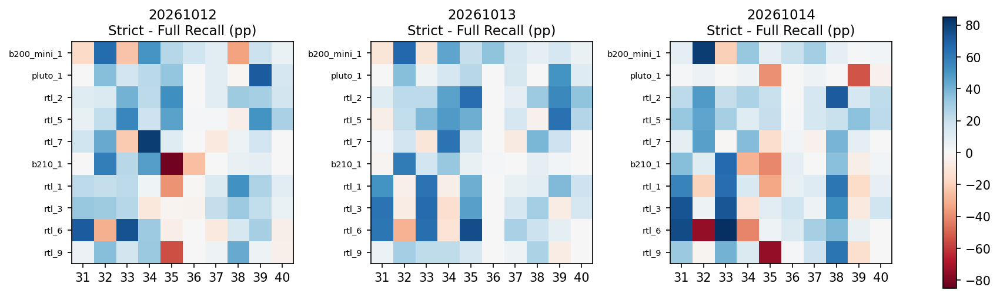
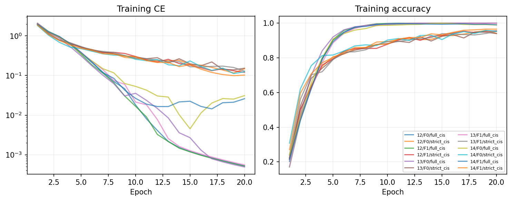

# B0 三seed类别退化复验

决定：**REPLICATED_LOCAL_DAMAGE_B1_REVIEW_ONLY**。固定20轮、Full/Strict×2fold×2新增seed，共8次实际训练完成；原20261012保留，共12个模型、三seed。没有重挑seed，没有训练重跑，没有最佳epoch选择。B1/B2训练均未开始。

| seed | complete | full_mean_accuracy | strict_mean_accuracy | mean_accuracy_delta | full_worst_RX_TX_recall | strict_worst_RX_TX_recall | serious_cells | declining_cells | worst_recall_delta | collapse_models |
| --- | --- | --- | --- | --- | --- | --- | --- | --- | --- | --- |
| 20261012 | True | 0.6837 | 0.8299 | 0.1462 | 0.11 | 0.005 | 9 | 24 | -0.82 | 0 |
| 20261013 | True | 0.67975 | 0.8686 | 0.18885 | 0.085 | 0.505 | 6 | 17 | -0.295 | 0 |
| 20261014 | True | 0.67475 | 0.8126 | 0.13785 | 0.005 | 0.045 | 14 | 21 | -0.75 | 0 |

Strict三个seed平均优势为**+14.620/+18.885/+13.785pp**。每seed严重RX×TX损害（Recall下降至少10pp）为9/6/14个；最严重Δ为−82/−29.5/−75pp。全RX×TX最低Strict Recall分别0.5%/50.5%/4.5%，对应Full11%/8.5%/0.5%。因此两个新增seed的总体最差类也改善；“每seed最差类都被牺牲”不成立。

至少2/3seed重复≥10pp损害的单元9个，跨7台RX、两个fold，均来自非collapse模型；其中**B200 mini TX33与RTL6 TX32在三个seed都下降≥10pp**。全部重复单元如下，不能把同折RX视为独立训练次数。

| receiver | fold | hardware_family | tx | seeds_observed | severe_seeds | noncollapsed_severe_seeds | severe_seed_ids | mean_delta_recall | min_delta_recall | max_delta_recall |
| --- | --- | --- | --- | --- | --- | --- | --- | --- | --- | --- |
| b200_mini_1 | 0 | USRP B200 mini | 31 | 3 | 2 | 2 | 20261012;20261013 | -0.06 | -0.16 | 0.085 |
| b200_mini_1 | 0 | USRP B200 mini | 33 | 3 | 3 | 3 | 20261012;20261013;20261014 | -0.18333 | -0.24 | -0.105 |
| rtl_7 | 0 | RTL-SDR | 33 | 3 | 2 | 2 | 20261012;20261013 | -0.11167 | -0.22 | -0.01 |
| b210_1 | 1 | USRP B210 | 35 | 3 | 2 | 2 | 20261012;20261014 | -0.38833 | -0.82 | 0.065 |
| rtl_1 | 1 | RTL-SDR | 35 | 3 | 2 | 2 | 20261012;20261014 | -0.1 | -0.385 | 0.415 |
| rtl_3 | 1 | RTL-SDR | 34 | 3 | 2 | 2 | 20261013;20261014 | -0.12 | -0.145 | -0.09 |
| rtl_6 | 1 | RTL-SDR | 32 | 3 | 3 | 3 | 20261012;20261013;20261014 | -0.44833 | -0.75 | -0.295 |
| rtl_6 | 1 | RTL-SDR | 34 | 3 | 2 | 2 | 20261013;20261014 | -0.07333 | -0.415 | 0.31 |
| rtl_9 | 1 | RTL-SDR | 35 | 3 | 2 | 2 | 20261012;20261014 | -0.38333 | -0.745 | 0.14 |

TX35的巨大下降主要在20261012/14出现，在20261013可消失或反向改善。失效幅度和身份有seed依赖，不能只复述旧seed的灾难案例。整体收益与局部可重复损害并存，支持B1对现有方法进行反证，不支持直接写新Loss。

模型优化诊断：12模型固定20轮、历史240行完整；无非有限损失，final train Acc范围94.01%–100.00%，无冻结的collapse flag。Full常接近100%训练Acc而源留出Acc较低；Strict训练误差仍高于Full，受表征/优化共同影响，不能纯归因于域对齐。新seed14 Full最终损失高于另两seed，保留其曲线，不能删掉以求好看。

新8个真实final.pt独立加载核验：config/epoch/源scaler一致，Adam每参数**3140次更新**，与ceil(10000/64)×20一致。相同seed四模型的初始payload完全配对；两个新seed初始化不同。独立重建60个model×RX预测、600个Recall、6000格confusion、全部严重重复率通过。历史分数由CPU缓存，新训练保存GPU末轮float32转float64输出；没有重复CPU推理，微小浮点边界不是同设备逐位复现声明。[核验](independent_verification.json)。

实测V100：八正式进程94.98–97.48秒，各20轮；训练内部status约90.62–92.51秒，其余初始化/来源核验/退出；四GPU两个队列轮次。全部正式进程加初始失败占用的保守累计 **0.22810 reserved GPUh**，在1小时上限内。它包含读取/评价，非纯CUDA kernel时间。保存了80,000个新增最终logits/标签/row索引（40个model×RX NPZ）；GPU每epoch源评价仅监测，不用来决策。权重与完整NPZ留服务器，不公开上传原始预测。

工程启动失败必须保留：首次8进程因我错误地把历史整个目录字节哈希要求一致，在创建优化器之前退出，优化步数0、无history/final。EISR已记录的g1_data新增访问校验函数和未导入shen_p2a.runner例外未被复用。修正为历史5661a32字节+所有旧函数AST相同、unused module不被导入的证明。保留所有初始status/log、original registration/seal/两份原源码；后续8个获准拟合任务用同seed/同配方完成，实际拟合8次、拟合重试0、换seed0。初始51.19 reserved-GPU秒纳入成本。科学阈值/样本/指标没有更改；见ENGINEERING_CORRECTION.json。

源码、历史日志、模型SHA、scaler/indices校验、逐RX/逐TX/全部5400方向margin、2700方向变化、优化状态与严重重复率均存证据包。没有OSU、开发/锁定RX、Day3/4或原始IQ访问。全部为历史源池探索性研究，不是独立盲测。
