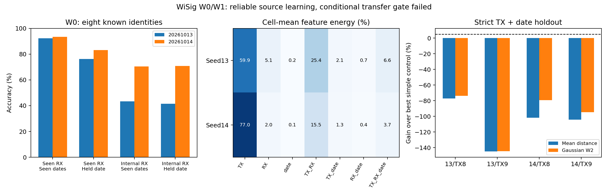

# WiSig W0/W1：交互可重复，但尚不能跨身份安全利用

2026-10-13，北京时间。**完成两个可信源域编码器和W1检验；当前证据不支持进入W2，正式/算法训练为0。** Shen固定rank2停止结论保持不变。

新方案检验接收条件变化的共同、交互和抽样成分，随后要求跨身份/日期预测及身份保持。不是把“统计交互存在”当作“已学会可部署接收机变换”。本轮遵守先W0/W1、后提交W2冻结决定的边界。

## W0：输入、硬件和实际划分

ZIP源SHA256仍为 `b0eca705816b03a47290286fd23ca1a10e02c6f9bd29b5461cfd92c13a86fbdd`，只读访问、没有覆盖或重新下载。Kaggle官方字节一致性仍未证明。受限buffer读取器拒绝未列出的pickle globals/persistent IDs，只转换已批准未等化开发单元；139852个包通过有限值/正能量检查，无无效包。公开来源哈希、位置协议、完整审计与空的无效样本清单。

官方硬件元数据给出32RX：N210×16、X310×9、B210×7，**三种型号，不是32种架构**。十TX均是Atheros_AR5212_AR5213型号的不同节点。天线、增益、RF子板配置、校准等未由本元数据确定，不能把硬件型号当作完整接收条件真值。

初始metadata循环分配16源/8内部/8最终；其源集合有整类缺失，训练前覆盖检查中止，零模型/零优化步骤。保持初始最终8RX不变，在24开发RX内按最低开发单元至少160包规则冻结14源、其余10内部；原登记/审计/计划快照完整保留。实际训练源每单元200包，没有根据模型结果换RX。

源14RX：18-19、18-2、3-19、8-7（B210）；1-19、1-20、14-7、19-2、2-1、2-19、20-20、7-7、8-8（N210）；24-13（X310）。只有一个源X310，不能推断该型号总体规律。

最终保留8RX：8-14、1-1、19-1、20-1、20-19、23-1、24-16、24-5。最后日期2021_03_23和等化版保持数值封存。完整ZIP解析不透明buffer字节以检验结构，**不意味着最终单元被转换成数值或用于模型**；最终RX/日期没有缓存、特征或性能结果。

日期2021_03_01/03_08训练及源内checkpoint选择，03_15用于留出日期。TX索引0–7用于encoder；7-14、8-20两TX从encoder与mapping拟合同时排除。W0报告是八已知身份分类，不是十类WiSig官方复现；W1严格未见身份只覆盖这两TX，不能声称穷尽所有身份划分。

## W0：标准模型及泛化结果

[官方d003 CNN](https://github.com/WiSig-dataset/wisig-examples/blob/master/py/d003_ManyRx_nrx.py)的PyTorch移植：相同五层卷积、SAME非对称padding、池化和NHWC flatten顺序，Dense100/80、Dropout0.5，八分类39940参数。每包RMS，无等化/CFO/频带处理。Adam0.0005、epsilon1e-7，Dense核L2=0.0001；最多100轮/source-only patience5。RX×日期×TX均衡批次；仅源内验证loss选checkpoint。未作超参搜索、重试或seed替换。

两个作业分别83轮/72轮，冻结第78轮/67轮。均通过eval-mode训练≥90%、源内验证≥85%的可信encoder门槛。

| seed | 冻结训练 | 源内验证 | 已见RX/日期独立包 | 已见RX/未见日期 | 内部新RX/已见日期 | 内部新RX/未见日期 |
| --- | --- | --- | --- | --- | --- | --- |
| 20261013 | 93.24% | 91.66% | 92.33% | 76.28% | 43.42% | 41.45% |
| 20261014 | 94.58% | 93.23% | 93.40% | 83.04% | 70.36% | 70.87% |

源内可靠学习与新RX鲁棒性是两件事：两seed新RX结果差异约27–29个百分点，不能宣布稳定的接收机泛化。内部RX包含部分缺类，表中Accuracy只对实际存在包计分；[覆盖表](internal_RX_class_coverage.csv)和每RX×日期的8类固定macro指标一并公开，缺类单元不得解释为分类器对该类失败。内部RX只是开发评估，已经使用的部分不再是独立盲测。上述差异不是硬件因果效应估计。

## W1：变化成分占多少，是否可重复？

源14RX×10TX×3日期完整单元，冻结80维表征，用每单元等权原型作正交全因子分解。日期0/1使用非encoder训练位置120–199，日期2使用全部有效包。比例是**当前encoder特征中cell均值的变化能量**，不是原始信号功率、硬件失真比例或ANOVA显著性。

| 成分 | seed13 | seed14 |
| --- | --- | --- |
| TX | 59.90% | 76.98% |
| RX | 5.07% | 1.99% |
| date | 0.23% | 0.14% |
| TX_RX | 25.39% | 15.45% |
| TX_date | 2.08% | 1.26% |
| RX_date | 0.74% | 0.42% |
| TX_RX_date | 6.58% | 3.75% |

RX整体主效应约2%–5%，TX×RX约15%–25%，三阶交互约4%–7%。确定性奇偶包重测给出的cell均值抽样不确定性代理约0.33%/0.44%，不能解释掉大部分观察交互，但未校准包间相关/会话不确定性，**不是物理噪声比例**，也不应加到上表100%中。

前三日期的TX×RX split-half余弦约0.993/0.985；前两日对第三日的交互余弦（十TX描述）约0.736/0.751，严格两留出TX子集约0.903/0.913。说明统计结构有重复性。这个描述计算观察了相同TX在不同日期的真实分布，**不是利用另外八TX预测两新TX**。该区别决定能否提出可迁移增强。

成分比例随encoder明显改变；没有独立硬件真值，RX、信道、日期/会话均可能纠缠。只在源14RX和三个开发日期内成立，不能外推最终8RX/日期或整个WiSig。

## W1：是否存在超过简单控制、身份保持的可预测剩余变化？

全部182个有向源RX对、两严格留出TX、两seed；同日独立包、日期0→1、日期0/1→2三种情况。Identity、Translation、CORAL和固定3邻居条件CORAL残余均值修正，共8736条预测指标；34944条八已见TX的变换后身份指标。

CORAL和条件修正从同一批八TX的包/原型获取信息，未使用跨RX逐包对应。固定3邻居诊断不是新算法或rank2重启：用源类均值查询八训练类的最近邻，预测CORAL留下的目标均值残余。它需要源类分布，面向有标签训练增强的假设检验，不是未知RX的部署识别器。

在真正严格TX+第三日期检验中，条件模型在四个seed×TX条件都明显劣于最强固定简单方法：

| seed | 留出TX节点 | 均值最佳简单控制 | 均值距离增加 | W2²距离增加 |
| --- | --- | --- | --- | --- |
| 20261013 | 7-14 | translation | 77.23% | 73.92% |
| 20261013 | 8-20 | identity | 144.87% | 144.62% |
| 20261014 | 7-14 | identity | 101.87% | 79.48% |
| 20261014 | 8-20 | identity | 104.41% | 94.83% |

条件变换还把八已知TX的冻结分类准确率从76.28%降至60.47%、从83.04%降至76.12%，分别损失15.81/6.92个百分点，超过允许2个百分点。已知类分类保持是实际head诊断；严格未知类的十原型检索使用真实目标类别分布，只是有标签参照，不是十类部署准确率。所有距离和检索逐组表均公开；不按每单元事后挑选最优方法构造部署选择器。

结论：**交互存在且可重测，但这次受控条件统计模型无法从其他TX跨日期预测并安全利用它。** 不能将失败解释为“没有任何可预测交互”，也不能凭重复性进入无约束变换生成训练。门槛四条件均失败，W2=0。

## Shen复盘：哪些能判定，哪些不能？

八个32维类原型中心化秩≤7，原变换高度欠定；CORAL获取包级整体协方差，rank2只拟合类均值；旧encoder有训练49.44%的条件。这三条均有事实支持。附件事后计数311/800（均值胜CORAL）、421/800（胜平移）、282/800（W2胜CORAL）、78/800（两指标胜全部控制）已独立复算。

旧实验没有控制这三个因素的分别改变，**不能判定哪项是主导原因**。WiSig本次source identity学习已可靠，条件预测仍失败，使“只需换可靠encoder就能得到共享变换”缺少支持，但不是对Shen失败作因果归因。所有Shen历史结果/代码保持不变，没有新Shen训练。

## 研究决定、W2窗口和资源

不值得执行当前条件变换生成W2。两个试验占用0.033114692 reserved GPUh；没有额外拟合、W2或W3。14源/10内部划分源于覆盖率，首次覆盖检查中止属于数据预检，完整保留，没有隐藏模型拟合失败。

[W2冻结决定](../../../docs/wisig_w01/W2_FROZEN_PLAN.md)设当前正式数量与申请预算为0。若后续用户提出并批准有区别的机制，可以参考12次同规模标准训练的计时估计0.2700GPUh（1.3系数），但那不是候选算法/强基线实际预算，也不是执行授权。最后RX/日期继续保留。

[RIEI](https://arxiv.org/abs/2411.03636)已研究TX/RX解耦；[DRIFT v2](https://arxiv.org/abs/2510.09405)采用对抗解耦与RX约束。[IB-RFF官方说明](https://signalprocessingsociety.org/publications-resources/ieee-transactions-information-forensics-and-security/2026/09/information)已讨论过度对齐与身份信息，阅读全文/实现仍不足；[ConstStyle](https://arxiv.org/html/2509.05975v1)将训练和测试风格投向统一域。普通风格变换、身份保持或低阶统计修正本身不能当作原创。当前没有通过实证门槛的候选机制，故没有论文创新性或发表能力结论。

输入许可为CC BY-NC-SA4.0；引用S.Hanna、S.Karunaratne、D.Cabric，WiSig，IEEE Access2022，DOI10.1109/ACCESS.2022.3154790，以及ORBIT testbed论文（Raychaudhuri等，WCNC2005）。代码/计划/全部结果/决定/证据索引出版，原IQ、缓存、特征、权重、私稿和凭证不出版。详细来源/完整协议见[注册](../../../configs/wisig_w01/registration.json)、[验证](verification.json)、[证据索引](EVIDENCE_INDEX.md)。
